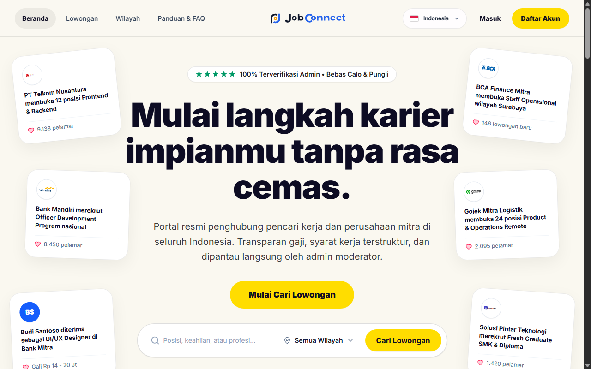
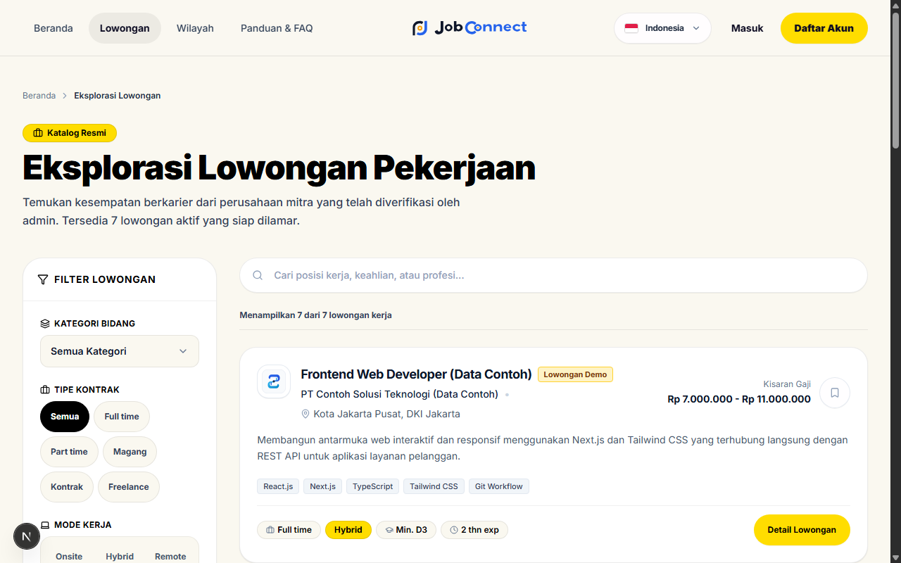
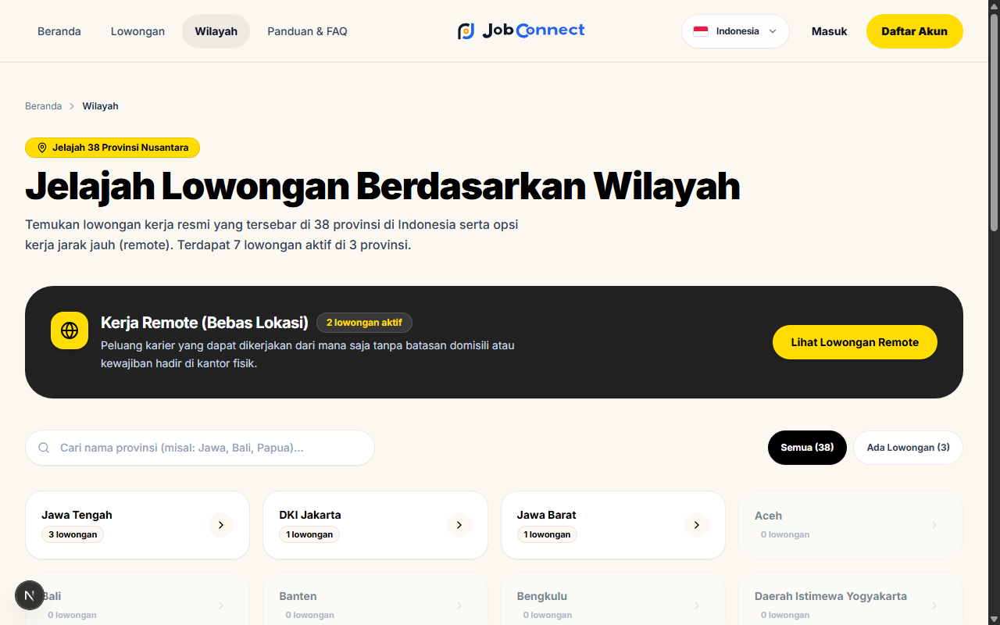
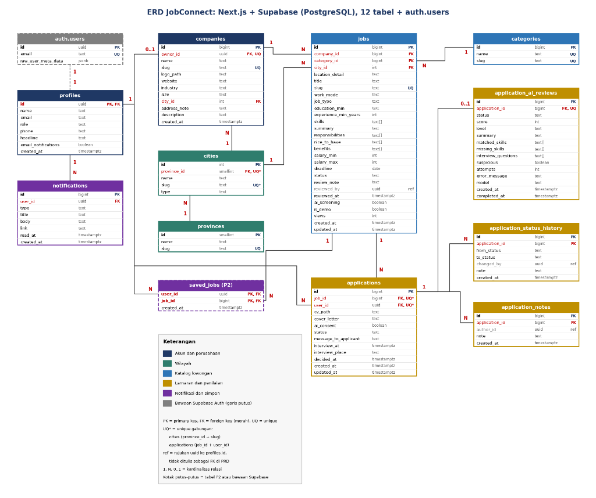

<p align="center">
  
</p>

<h1 align="center">JobConnect</h1>

<p align="center">
  <b>Sistem Informasi Lowongan Pekerjaan Terpercaya se-Indonesia</b><br>
  Platform rekrutmen modern yang menghubungkan talenta pencari kerja dengan perusahaan mitra terverifikasi di 38 provinsi secara aman, transparan, dan bebas calo.
</p>

<p align="center">
  <a href="https://jobconnect.web.id" target="_blank">
    
  </a>
  <a href="https://vercel.com" target="_blank">
    
  </a>
  <a href="https://supabase.com" target="_blank">
    
  </a>
  <a href="https://www.typescriptlang.org" target="_blank">
    
  </a>
</p>

<p align="center">
  <a href="https://jobconnect.web.id"><b>🌐 Kunjungi Web Resmi</b></a> •
  <a href="#fitur-utama-dan-keunggulan"><b>✨ Fitur Unggulan</b></a> •
  <a href="#tangkapan-layar"><b>🖼️ Pratinjau Tampilan</b></a> •
  <a href="#teknologi-dan-arsitektur"><b>🛠️ Teknologi</b></a> •
  <a href="#akun-demo-untuk-pengujian"><b>🔑 Akun Demo</b></a> •
  <a href="docs/ERD.md"><b>📊 Skema ERD</b></a>
</p>

---

## Tentang Proyek

**JobConnect** adalah aplikasi web portal kerja *full-stack* yang dibangun untuk mengatasi berbagai tantangan umum dalam proses pencarian kerja dan rekrutmen di Indonesia. Mulai dari masalah minimnya kepastian status lamaran (*ghosting*), maraknya penipuan lowongan bodong, ketidakjelasan rentang gaji, hingga terpusatnya lowongan kerja hanya di kota-kota besar.

JobConnect menghadirkan ekosistem rekrutmen yang berimbang antara **Pencari Kerja (Pelamar)**, **Perusahaan Mitra (Rekruter)**, dan **Pengelola (Admin Platform)** dengan standar keamanan data tinggi, transparansi alur seleksi, serta antarmuka yang ramah pengguna baik di perangkat ponsel cerdas (*mobile-first*) maupun komputer desktop.

---

## Tautan Akses Produksi

Aplikasi JobConnect telah aktif dan dapat diakses publik melalui domain resmi berikut:

* **Domain Utama**: [https://jobconnect.web.id](https://jobconnect.web.id)
* **Portal Masuk Akun**: [https://jobconnect.web.id/login](https://jobconnect.web.id/login)
* **Pendaftaran Mitra Perusahaan**: [https://jobconnect.web.id/perusahaan/register](https://jobconnect.web.id/perusahaan/register)
* **Eksplorasi Wilayah 38 Provinsi**: [https://jobconnect.web.id/wilayah](https://jobconnect.web.id/wilayah)

---

## Fitur Utama dan Keunggulan

### 1. Untuk Pencari Kerja (Pelamar)
* **Etalase Portofolio & Proyek (Showcase):** Pelamar dapat memajang tautan karya terbaik, deskripsi proyek, dan gambar pratinjau visual untuk membuktikan keterampilan nyata secara langsung.
* **Linimasa Seleksi Transparan (Anti-Ghosting):** Pelacakan status lamaran terstruktur dalam 8 tahapan (`dikirim`, `ditinjau`, `kandidat terpilih`, `wawancara`, `penawaran kerja`, `diterima`, `ditolak`, atau `ditarik mandiri`) dengan indikator waktu proses (SLA).
* **Pencarian & Penyaringan Loker Presisi:** Jelajah lowongan berdasarkan 38 provinsi, 514 kota/kabupaten, kategori industri, tipe pekerjaan (penuh waktu, paruh waktu, magang, kontrak, lepas), dan sistem kerja (onsite, hybrid, remote).
* **Simpan Lowongan Favorit (Bookmark):** Simpan peluang kerja yang menarik untuk dilamar kemudian hari melalui dasbor tersimpan.
* **Perlindungan Berkas CV:** Dokumen CV pelamar (PDF maksimal 2 MB) disimpan dalam ruang aman privat (*Private Storage Bucket*) dengan tautan bertanda tangan digital (*Signed URL*) berbatas waktu 5 menit.
* **Dukungan Dwi-Bahasa (Bilingual):** Pilihan bahasa instan antara Bahasa Indonesia dan Bahasa Inggris pada seluruh halaman utama.

### 2. Untuk Perusahaan Mitra (Rekruter)
* **Registrasi B2B Mandiri (Model Loker.id):** Pendaftaran resmi perusahaan dengan narahubung HRD (PIC), legalitas instansi, email kantor, dan nomor WhatsApp.
* **Onboarding Terpandu:** Kewajiban melengkapi identitas legal perusahaan (logo, industri, alamat operasional, website) sebelum diizinkan mempublikasikan lowongan kerja.
* **Papan Seleksi Kandidat (ATS & Kanban):** Kelola lamaran masuk dengan tampilan papan visual untuk memudahkan pemindahan tahapan kandidat secara cepat.
* **Kategori Dinamis:** Kemudahan menentukan atau menambahkan kategori bidang pekerjaan baru jika belum tercantum dalam sistem.
* **Integrasi Komunikasi Instan:** Tombol satu-klik untuk menghubungi pelamar via WhatsApp atau mengirim draf email resmi penerimaan kerja langsung melalui aplikasi Gmail.
* **Manajemen Wawancara & Catatan Tim:** Kirim jadwal wawancara (tanggal, jam, tautan pertemuan/lokasi fisik) dan tulis catatan evaluasi rahasia antar rekruter.
* **Rekapitulasi Data:** Ekspor laporan data pelamar dan lowongan kerja ke format lembar sebar (CSV/Excel) serta dokumen cetak PDF.

### 3. Untuk Pengelola (Admin Platform)
* **Moderasi Ketat Anti-Penipuan:** Setiap draf lowongan baru wajib diverifikasi dan disetujui (ACC) oleh admin sebelum dapat dilihat publik.
* **Manajemen & Pembekuan Mitra:** Kontrol penuh untuk meninjau legalitas mitra dan membekukan akun perusahaan yang terindikasi melanggar aturan.
* **Proteksi Akses Berlapis (Role Guarding):** Isolasi ketat hak akses antara pelamar, perusahaan, dan admin melalui Next.js Middleware dan aturan otorisasi server.
* **Filter Kata Tidak Pantas:** Deteksi otomatis nama dan teks tidak senonoh (*profanity filter*) dengan normalisasi karakter leetspeak pada seluruh formulir.

---

## Tangkapan Layar

<p align="center">
  
</p>

<p align="center">
  
  
</p>

---

## Teknologi dan Arsitektur

<p align="left">
  
  
  
  
  
  
  
  
</p>

| Lapisan Sistem | Pilihan Teknologi | Implementasi dan Peran |
| --- | --- | --- |
| **Frontend Framework** | Next.js (App Router), React, TypeScript | Rendering dinamis (SSR), Server Components, Server Actions, navigasi cepat |
| **Desain Antarmuka** | Tailwind CSS, Lucide Icons | Antarmuka bersih bergaya modern, tata letak adaptif ponsel (*mobile-first*) |
| **Basis Data & Auth** | Supabase, PostgreSQL | Relasi data ACID, otentikasi aman (Email/Password & Google OAuth) |
| **Keamanan Data** | PostgreSQL Row Level Security (RLS) | Isolasi data pada level basis data, proteksi kolom peran (`REVOKE UPDATE role`) |
| **Penyimpanan Berkas** | Supabase Storage (Private Bucket) | Enkripsi berkas CV PDF dengan token tanda tangan digital sementara (Signed URL) |
| **Validasi Formulir** | Zod, Custom Profanity Engine | Validasi skema tipe data ketat, penapisan kata kasar dan masukan berbahaya |
| **Infrastruktur Cloud** | Vercel Serverless & Citrahost DNS | Distribusi konten global (*Edge Network*), sertifikat SSL otomatis, koneksi cepat |

---

## Skema Basis Data

Sistem JobConnect dirancang dengan arsitektur relasional yang rapi dan teroptimasi. Dokumentasi struktur tabel, relasi entitas, dan kamus data dapat dibaca secara lengkap pada berkas [docs/ERD.md](docs/ERD.md).

<p align="center">
  
</p>

---

## Akun Demo untuk Pengujian

Penguji, rekruter, atau reviewer dapat langsung menjelajahi sistem menggunakan akun demo berikut:

| Peran Akun | Alamat Email | Kata Sandi | Ruang Lingkup Akses |
| --- | --- | --- | --- |
| **Pelamar (Pencari Kerja)** | `abryan.yoga@jobconnect.id` | `Password123!` | Melamar pekerjaan, kelola portofolio showcase, simpan lowongan, pantau status seleksi |
| **Perusahaan Mitra** | `perusahaan.demo@jobconnect.id` | `Password123!` | Pasang lowongan baru, seleksi pelamar di papan ATS, jadwalkan wawancara, ekspor laporan |
| **Admin Platform** | `admin.demo@jobconnect.id` | `Password123!` | Moderasi persetujuan loker (ACC), kelola verifikasi mitra, master kategori, rekapitulasi data |

---

## Panduan Instalasi Lokal

Bagi pengembang yang ingin menjalankan proyek ini di lingkungan lokal (*local development*):

### 1. Kloning Repositori
```bash
git clone https://github.com/AbryanYoga/JobConnect.git
cd JobConnect
```

### 2. Pemasangan Dependensi
```bash
npm install
```

### 3. Konfigurasi Variabel Lingkungan
Salin berkas contoh konfigurasi:
```bash
cp .env.example .env.local
```
Lengkapi berkas `.env.local` dengan kredensial proyek Supabase Anda:
```env
NEXT_PUBLIC_SUPABASE_URL=https://proyek-anda.supabase.co
NEXT_PUBLIC_SUPABASE_ANON_KEY=kunci-anon-proyek-anda
```

### 4. Eksekusi Skrip Database
Jalankan berkas migrasi SQL yang tersedia di folder `database/` melalui SQL Editor di Supabase secara berurutan:
1. `schema.sql`: Pembuatan struktur tabel dan indeks
2. `policies.sql`: Konfigurasi kebijakan keamanan data (Row Level Security)
3. `functions.sql`: Fungsi basis data dan trigger otomatis
4. `seed_wilayah.sql`: Master data 38 provinsi dan 514 kabupaten/kota se-Indonesia
5. `seed_demo_accounts.sql`: Data akun percontohan (opsional)

### 5. Jalankan Server Pengembangan
```bash
npm run dev
```
Buka peramban di `http://localhost:3000` untuk mulai menjelajahi aplikasi.

---

## Struktur Folder Proyek

```text
JobConnect/
├── app/                          # Halaman dan rute aplikasi (Next.js App Router)
│   ├── (auth)/                   # Halaman masuk, pendaftaran, dan autentikasi
│   ├── 403/                      # Halaman penolakan akses otorisasi
│   ├── admin/                    # Dasbor moderasi platform dan verifikasi loker
│   ├── api/                      # Titik akhir API unduh berkas dan integrasi
│   ├── lamar/                    # Formulir pengajuan berkas lamaran kerja
│   ├── lamaran-saya/             # Pelacakan linimasa status lamaran pelamar
│   ├── lowongan/                 # Katalog pencarian dan rincian pekerjaan
│   ├── mitra/                    # Portal perusahaan (kelola lowongan, papan ATS)
│   ├── notifikasi/               # Notifikasi riwayat lamaran dan wawancara
│   ├── perusahaan/               # Halaman informasi dan registrasi mitra instansi
│   ├── profil/                   # Profil biodata, LinkedIn, dan etalase karya
│   ├── tersimpan/                # Daftar lowongan favorit pelamar
│   ├── wilayah/                  # Direktori lowongan per provinsi dan kota
│   └── page.tsx                  # Halaman beranda utama JobConnect
├── components/                   # Komponen antarmuka yang dapat digunakan kembali
│   ├── admin/                    # Panel moderasi dan statistik platform
│   ├── beranda/                  # Bagian hero, kategori, dan kotak pencarian
│   ├── layout/                   # Navbar, footer, dan pengalih bahasa
│   ├── lowongan/                 # Kartu loker, filter pencarian, dan status kosong
│   ├── mitra/                    # Papan ATS pelamar, catatan tim, form lowongan
│   ├── profil/                   # Showcase portofolio dan manajemen data diri
│   └── ui/                       # Tombol, masukan formulir, skeleton, dan badge
├── database/                     # Naskah SQL skema, fungsi, dan kebijakan RLS
├── docs/                         # Spesifikasi PRD, dokumentasi ERD, dan tangkapan layar
├── lib/                          # Fungsi utilitas, validasi Zod, kamus i18n, klien Supabase
└── public/                       # Berkas statis, favicon, dan logo resmi JobConnect
```

---

## Pengembang

Aplikasi **JobConnect** dirancang, dibangun, dan dikembangkan oleh:

**Abryan Yoga Pratama**  
*Rekayasa Perangkat Lunak - SMK Negeri 6 Surakarta*

* 🌐 **Situs Proyek**: [jobconnect.web.id](https://jobconnect.web.id)
* 🐙 **GitHub**: [@AbryanYoga](https://github.com/AbryanYoga)
* 💼 **LinkedIn**: [Abryan Yoga Pratama](https://www.linkedin.com/in/abryan-yoga-pratama-231bb141a/)
* 📧 **Email Kontak**: [abryanyogapratama@gmail.com](mailto:abryanyogapratama@gmail.com)

---

<p align="center">
  Dilisensikan di bawah <a href="LICENSE">MIT License</a>. Hak Cipta © 2026 JobConnect.
</p>
