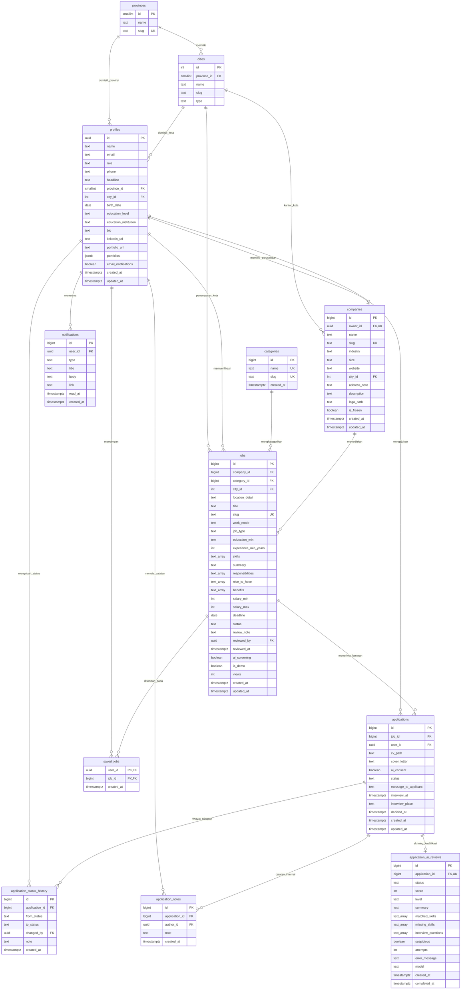

# Entity Relationship Diagram (ERD) - JobConnect

Dokumen ini memuat diagram relasi entitas (Entity Relationship Diagram) serta spesifikasi kamus data lengkap untuk platform sistem informasi lowongan kerja **JobConnect**.

---

## 1. Diagram Relasi Entitas (Mermaid)

---

## 2. Deskripsi Entitas dan Struktur Data

### 2.1 provinces (Provinsi)
Menampung data master 38 provinsi di seluruh Indonesia sesuai standar kode wilayah nasional.
- **id** (smallint, PK): Kode unik resmi provinsi (misal: 11 untuk Aceh, 31 untuk DKI Jakarta).
- **name** (text): Nama lengkap provinsi resmi.
- **slug** (text, UNIQUE): Pengenal ramah URL (misal: `dki-jakarta`, `jawa-tengah`).

### 2.2 cities (Kota dan Kabupaten)
Menampung data master 514 kota dan kabupaten di Indonesia.
- **id** (int, PK): Kode unik kota/kabupaten.
- **province_id** (smallint, FK -> provinces.id): Relasi ke provinsi induk.
- **name** (text): Nama daerah (termasuk prefiks "Kota" atau "Kabupaten").
- **slug** (text): Slug ramah URL.
- **type** (text): Jenis administrasi (`kota` atau `kabupaten`).

### 2.3 profiles (Profil Pengguna dan Pelamar)
Menyimpan biodata pengguna dari seluruh peran (Pencari Kerja, Mitra Perusahaan, Administrator).
- **id** (uuid, PK): Terhubung langsung ke `auth.users(id)` di Supabase Auth.
- **name** (text): Nama lengkap pengguna.
- **email** (text): Alamat email resmi (disinkronkan via database trigger).
- **role** (text): Peran akun (`user`, `company`, atau `admin`).
- **phone** (text): Nomor telepon / kontak aktif (WhatsApp).
- **headline** (text): Gelar profesional singkat (misal: "Junior Web Developer").
- **province_id** (smallint, FK -> provinces.id): Domisili provinsi pelamar.
- **city_id** (int, FK -> cities.id): Domisili kota/kabupaten pelamar.
- **birth_date** (date): Tanggal lahir (untuk perhitungan usia otomatis).
- **education_level** (text): Tingkat pendidikan terakhir (`SMA/SMK`, `D3`, `S1`, `S2`, dsb).
- **education_institution** (text): Nama sekolah, politeknik, atau universitas.
- **bio** (text): Narasi deskripsi diri dan ringkasan kemampuan kandidat.
- **linkedin_url** (text): Tautan profil jejaring profesional LinkedIn.
- **portfolio_url** (text): Tautan situs web portofolio pribadi.
- **portfolios** (jsonb): Koleksi proyek unggulan (judul, deskripsi, tautan, gambar).
- **email_notifications** (boolean): Preferensi kirim notifikasi via email.

### 2.4 companies (Profil Mitra Perusahaan)
Menampung profil legal dan data identitas perusahaan pemasang lowongan.
- **id** (bigint, PK): ID numerik perusahaan.
- **owner_id** (uuid, UNIQUE, FK -> profiles.id): Relasi akun pemilik instansi.
- **name** (text): Nama resmi perusahaan atau instansi.
- **slug** (text, UNIQUE): Slug unik halaman profil publik instansi.
- **industry** (text): Bidang industri (Teknologi Informasi, Manufaktur, dll).
- **size** (text): Rentang skala karyawan (1-10, 11-50, 51-200, dst).
- **website** (text): Alamat situs web resmi instansi.
- **city_id** (int, FK -> cities.id): Lokasi kota kantor operasional.
- **address_note** (text): Alamat lengkap kantor fisik.
- **description** (text): Profil visi, misi, dan deskripsi bisnis perusahaan.
- **logo_path** (text): Path berkas logo instansi pada Supabase Storage.
- **is_frozen** (boolean): Status pembekuan instansi oleh admin jika terindikasi bodong/melanggar hukum (default: false).

### 2.5 categories (Kategori Bidang Pekerjaan)
Katalog klasifikasi profesi untuk memudahkan penemuan lowongan.
- **id** (bigint, PK): ID kategori.
- **name** (text, UNIQUE): Nama kategori lowongan.
- **slug** (text, UNIQUE): Slug kategori lowongan.

### 2.6 jobs (Daftar Lowongan Pekerjaan)
Menampung seluruh data lowongan pekerjaan yang diajukan oleh mitra perusahaan.
- **id** (bigint, PK): ID numerik lowongan.
- **company_id** (bigint, FK -> companies.id): Perusahaan pemilik lowongan.
- **category_id** (bigint, FK -> categories.id): Kategori profesi lowongan.
- **city_id** (int, FK -> cities.id): Kota penempatan kerja.
- **location_detail** (text): Rincian area kerja atau kantor cabang.
- **title** (text): Judul posisi pekerjaan (maksimal 80 karakter).
- **slug** (text, UNIQUE): Tautan ramah URL untuk halaman detail lowongan.
- **work_mode** (text): Mode kerja (`onsite`, `hybrid`, `remote`).
- **job_type** (text): Tipe ikatan kerja (`full_time`, `part_time`, `magang`, `kontrak`, `freelance`).
- **education_min** (text): Kualifikasi pendidikan minimal.
- **experience_min_years** (int): Syarat pengalaman kerja minimal (tahun).
- **skills** (text[]): Daftar keahlian teknis utama (maksimal 8 item).
- **summary** (text): Ringkasan singkat peran kerja (maksimal 280 karakter).
- **responsibilities** (text[]): Rincian tanggung jawab pekerjaan utama.
- **nice_to_have** (text[]): Nilai tambah kualifikasi kandidat.
- **benefits** (text[]): Fasilitas dan tunjangan kerja.
- **salary_min** & **salary_max** (int): Rentang gaji transparan bulanan.
- **deadline** (date): Batas akhir pengajuan lamaran.
- **status** (text): Status alur lowongan (`draft`, `pending`, `open`, `rejected`, `closed`, `removed`).
- **review_note** (text): Catatan verifikasi resmi dari administrator moderator.
- **reviewed_by** (uuid, FK -> profiles.id): Admin pemeriksa lowongan.
- **reviewed_at** (timestamptz): Waktu persetujuan (ACC) atau penolakan lowongan.
- **is_demo** (boolean): Penanda data demonstrasi pengujian.

### 2.7 applications (Berkas Lamaran Kerja)
Menampung interaksi pengajuan lamaran dari pencari kerja ke lowongan aktif.
- **id** (bigint, PK): ID transaksi lamaran.
- **job_id** (bigint, FK -> jobs.id): Lowongan yang dilamar.
- **user_id** (uuid, FK -> profiles.id): Akun pencari kerja yang melamar.
- **cv_path** (text): Lokasi berkas PDF CV pada bucket privat Supabase Storage.
- **cover_letter** (text): Pesan perkenalan dan motivasi kerja.
- **ai_consent** (boolean): Opsi pelamar untuk persetujuan pembacaan kualifikasi berkas.
- **status** (text): Status proses 8 tahapan (`dikirim`, `ditinjau`, `shortlist`, `wawancara`, `offered`, `diterima`, `ditolak`, `ditarik`).
- **message_to_applicant** (text): Catatan atau umpan balik resmi dari HR perusahaan.
- **interview_at** (timestamptz): Jadwal pelaksanaan wawancara kerja.
- **interview_place** (text): Lokasi kantor fisik atau tautan pertemuan virtual.
- **decided_at** (timestamptz): Waktu penetapan keputusan akhir penerimaan atau penolakan.

### 2.8 application_status_history (Riwayat Linimasa Lamaran)
Audit trail transparan yang mencatat setiap perubahan tahapan lamaran.
- **id** (bigint, PK): ID log linimasa.
- **application_id** (bigint, FK -> applications.id): Lamaran terkait.
- **from_status** & **to_status** (text): Perubahan tahapan status.
- **changed_by** (uuid, FK -> profiles.id): Pengguna yang mengubah status.
- **note** (text): Catatan alasan perubahan status.

### 2.9 application_notes (Catatan Internal Rekruter)
Ruang kolaborasi privat antar-anggota tim HR perusahaan untuk mendiskusikan kandidat.
- **id** (bigint, PK): ID catatan.
- **application_id** (bigint, FK -> applications.id): Kandidat terkait.
- **author_id** (uuid, FK -> profiles.id): Penulis catatan internal.
- **note** (text): Konten pembahasan internal kandidat.

### 2.10 application_ai_reviews (Skrining Kualifikasi Terstruktur)
Menyimpan hasil analisis kecocokan kualifikasi berkas terhadap kriteria lowongan.
- **id** (bigint, PK): ID analisis.
- **application_id** (bigint, UNIQUE, FK -> applications.id): Berkas lamaran terkait.
- **status** (text): Status evaluasi (`pending`, `processing`, `done`, `failed`, `skipped`).
- **score** (int): Nilai estimasi kecocokan kualifikasi (skala 0 sampai 100).
- **level** (text): Predikat kesesuaian kandidat.
- **summary** (text): Ringkasan pertimbangan kualifikasi kandidat.
- **matched_skills** & **missing_skills** (text[]): Keahlian yang cocok dan belum terpenuhi.
- **interview_questions** (text[]): Rekomendasi topik pertanyaan wawancara.

### 2.11 saved_jobs (Lowongan Tersimpan)
Fitur penanda (bookmark) lowongan favorit pelamar untuk dibaca atau dilamar nanti.
- **user_id** (uuid, PK, FK -> profiles.id): Akun pelamar.
- **job_id** (bigint, PK, FK -> jobs.id): Lowongan yang disimpan.
- **created_at** (timestamptz): Waktu penyimpanan.

### 2.12 notifications (Pusat Notifikasi Realtime)
Pemberitahuan aktivitas penting seputar akun, lowongan, dan lamaran.
- **id** (bigint, PK): ID notifikasi.
- **user_id** (uuid, FK -> profiles.id): Penerima notifikasi.
- **type** (text): Kategori peristiwa notifikasi.
- **title** (text): Judul ringkas pemberitahuan.
- **body** (text): Pesan detail notifikasi.
- **link** (text): Tautan langsung ke halaman terkait.
- **read_at** (timestamptz): Waktu notifikasi dibaca oleh pengguna.

---

## 3. Kebijakan Keamanan dan Hak Akses (Row Level Security)

Seluruh tabel di atas dilindungi oleh **Row Level Security (RLS)** bawaan PostgreSQL:
1. **Pemisahan Peran Mutlak**: Tamu publik hanya dapat membaca lowongan yang berstatus `open` serta profil perusahaan resmi.
2. **Kerahasiaan Berkas CV**: Berkas CV pada bucket privat `cvs` hanya dapat dibaca oleh pemilik lamaran dan perusahaan mitra tempat berkas diajukan.
3. **Pencegahan Akses Ilegal**: Pengguna umum diblokir dari mengubah kolom `role`, status persetujuan lowongan, maupun status pembekuan instansi.

